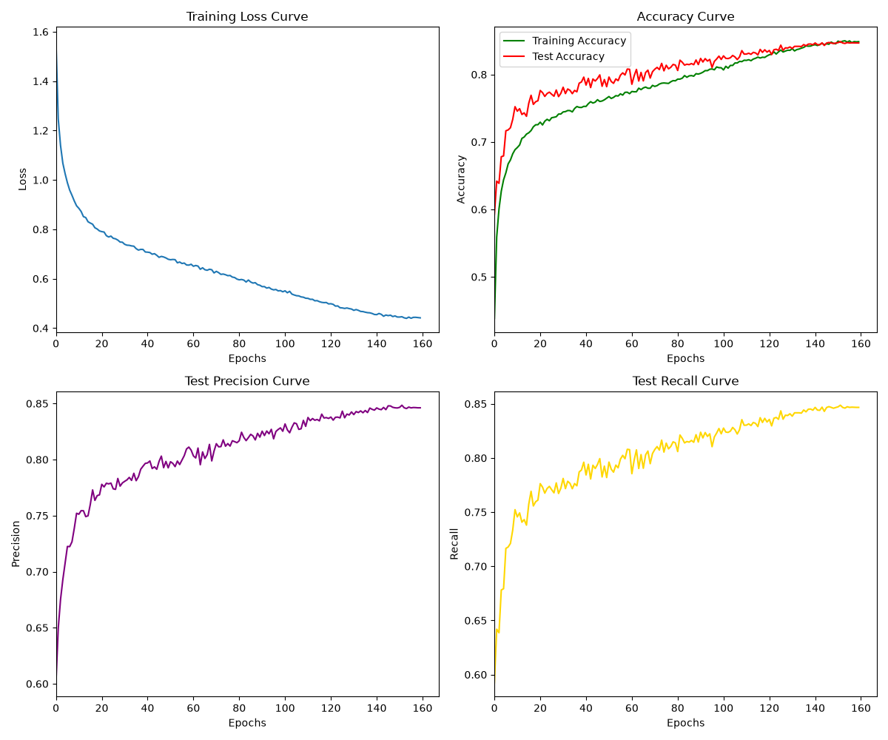

```markdown
# CIFAR-10 Image Classification Baseline (From Scratch)

本项目是一个从零开始（From Scratch）在 CIFAR-10 数据集上训练的卷积神经网络图像分类基线模型。

## 📊 训练结果 (Results)

在经过 160 个 Epoch 的训练后，模型达到了完全收敛，且展现出了极佳的泛化能力（无过拟合现象）。

*   **测试集准确率 (Test Accuracy):** ~84.0%
*   **训练损失 (Final Training Loss):** ~0.40

### 训练曲线 (Training Curves)



**曲线分析:**
*   **Loss Curve:** 平稳下降，并在余弦退火（Cosine Annealing）后期趋于平滑。
*   **Accuracy Curve:** 由于训练时使用了强数据增强（Data Augmentation），前期 Test Accuracy 高于 Train Accuracy；随着训练深入，两者在第 150 Epoch 后完美汇合，说明模型泛化能力极强，未发生过拟合。
*   **Precision & Recall:** 各分类指标均衡，模型对 CIFAR-10 十个类别均具备良好的识别能力。

## 🛠️ 环境依赖 (Requirements)

建议使用 Python 3.13+ 和 PyTorch 1.10+ 环境。

安装依赖：
```bash
pip install -r requirements.txt
```

## 📁 项目结构 (Project Structure)

```text
.
├── .vscode/                 # VS Code 配置文件
├── configs/
│   └── train_config.yaml    # 训练超参数配置文件
├── data/
│   └── cifar-10-batches-py/ # CIFAR-10 数据集解压目录(不上传)
├── datasets/
│   └── cifar10_dataset.py   # 数据加载与预处理脚本
├── docs/
│   └── experiment_doc.md    # 实验文档说明
├── evaluation/
|   └── test.py              #
├── experiments/
│   ├── all_curves.png       # 训练过程生成的四格曲线图
│   └── resnet18_cifar10.pth # 训练保存的模型权重文件 
├── losses/
│   └── loss_fn.py           # 损失函数定义 
├── models/
│   └── resnet18.py          # 网络结构定义 (ResNet-18)
├── scripts/
│   └── train.py             # 主训练脚本
├── tools/
│   └── utils.py             # 工具函数 (如日志记录、指标计算等)
├── .gitignore               # Git 忽略文件配置
├── readme.md                # 项目说明文档
└── requirements.txt         # 项目依赖列表
```

## 核心训练策略 (Training Strategy)

· 网络结构 (Model): ResNet-18
· 优化器 (Optimizer): SGD (Stochastic Gradient Descent)
  · lr = 1e-2 (初始学习率)
  · momentum = 0.9
  · weight_decay = 5e-4 (L2 正则化)
· 学习率调度 (Scheduler): CosineAnnealingLR
  · T_max = 160 (与训练 Epoch 同步)
· 数据增强 (Data Augmentation):
  · RandomCrop(32, padding=4)
  · RandomHorizontalFlip()
  · RandomErasing(p=0.5)
· 数据标准化 (Normalization): CIFAR-10 全局均值 (0.4914, 0.4822, 0.4465) 和标准差 (0.2023, 0.1994, 0.2010)。

 如何运行 (Quick Start)

1. 克隆项目并进入目录:

```bash
git clone https://github.com/jin-huia/CIFAR10-PyTorch-Classification
cd CIFAR10-PyTorch-Classification
```

2. 准备数据集:
确保 CIFAR-10 数据集已下载，或让 torchvision.datasets 自动下载至 ./data 目录。

3. 开始训练:

```bash
python scripts/train.py --config configs/train_config.yaml
```

4. 查看日志与曲线:
训练过程中的日志会输出到终端，训练结束后会生成 all_curves.png 曲线图。
📈 后续优化方向 (Future Work)
☐ 引入 CutMix 或 Mixup 数据增强策略。
☐ 尝试使用 Label Smoothing (标签平滑) 损失函数。
☐ 延长训练周期至 200+ Epochs，并加入 Warmup。
☐ 更换容量更大的网络结构（如 WideResNet）。
